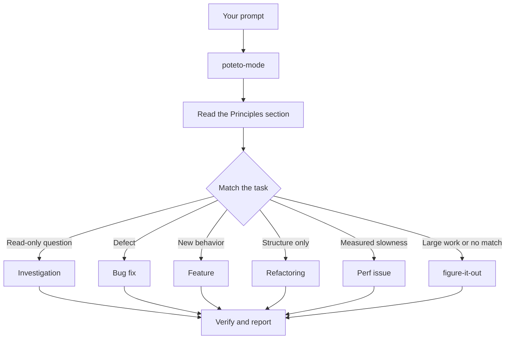

# `/poteto-mode` で作業を振り分ける（Route work through `/poteto-mode`）

`/poteto-mode` は入口である。目標を渡すと、22 のプレイブックから合うものを 1 つ選び、そのプレイブックの手順を todo list に写し、手順が必要とするときにほかのスキルを呼ぶ。このページでは、よいプロンプトとはどんなものか、そして実際にはどれだけ短くてよいかを説明する。


## プロンプトがどう処理されるか（What happens to your prompt）



図は、よく使われる振り分け先を示している。ほかにも、指標の山登り、実行時の症状や取得済みのトレースの診断、プロトタイプ、見た目の一致、スキルの作成と評価、自律実行、PR を開く、PR やスタックをマージできる状態まで見守る、検証済みのスタックを出す、PR のキューやスタックを autopilot で進める、セッションの引き継ぎ、安全な一時停止、複数フェーズの計画、worktree の片付けのためのプレイブックがある。全体は [プレイブックのディレクトリ](../../skills/poteto-mode/playbooks/) にある。

## 形式ではなく目標を伝える（Say the goal, not the ceremony）

仕様書は書かない。何がおかしいのか、何をしたいのかを伝え、すでに知っていてエージェントの手間を省けることがあれば添える。

```text
/poteto-mode users get two notifications after a retry. repro first, then fix and verify.
```

これはバグ修正（Bug fix）のプロンプトである。「repro first」（先に再現する）は礼儀として添えた言葉ではなく本当の制約であり、プレイブックはそれを守る。todo list がバグ修正の手順で埋まっていくのを確認する。

## プロンプトに何を入れるか（What goes in a prompt）

役に立つプロンプトに含めるものは最大 5 つで、どれも 1 文で書ける。

- **目標。** 何がおかしいのか、何をしたいのかを伝える。
- **完了の確認。** 通るか落ちるかが決まるものでなければならない。「もっとよくして」や「1 時間これに取り組んで」は確認にならない。
- **見たい証拠。** 実際のコマンドの出力、操作の流れの動画、保存された値、変更前後の数値を求める。
- **すでに知っていること。** 症状、再現の手順、ログの 1 行、リンクがあれば、エージェントは探す手間が省ける。
- **本当の制約。** 「repro first」（先に再現する）、「don't change any code yet」（まだコードを変えない）、「zero behavior change」（振る舞いを一切変えない）、「let me review before proceeding」（先に進む前にレビューさせて）は、どれもエージェントの行動を変える。

5 つすべてを含むプロンプトの例を示す。

```text
/poteto-mode the csv export drops its last row since yesterday's deploy. failing job id is 4812. repro first, then fix. done means the 60k-row fixture exports every row. show me the row counts before and after.
```

入れないほうがよいものが 2 つある。

- **やり方。** 何を達成したいかを伝え、自分が選ぶ道よりよい道をエージェントが見つける余地を残す。使うスキルを並べることも同様で、下の落とし穴で説明する。
- **原因についての自分の仮説（最初のうちは）。** 推測を伝えると、探す範囲が指し示した場所に狭まる。自分の見立てを伝える前に、エージェントに問題を言い直させる。

長いスレッドや曖昧なバグのように雑音の多い報告では、言い直しを最初の手順にする。

```text
/poteto-mode read this thread. restate the underlying issue in your own words, in plain english. don't change any code yet.
```

読み違いは、コードがまだ何もないうちに、言い直しの中に現れる。そこで訂正すれば、間違った修正 1 回分ではなく、メッセージ 1 通分の手間で済む。プレイブックを使わずに言い直しだけをさせたいときは、[`/in-your-own-words`](../../skills/in-your-own-words/SKILL.md) を実行する。エージェントが、ユーザーの目標と、ユーザーが解こうとしている問題をどう理解しているかを言い直す。

プロンプトの狙いが合っているか自信がないときは、送る前に [`/sharpen`](../../skills/sharpen/SKILL.md) にかける。

```text
/sharpen write a migration guide for the v2 config format.
```

エージェントは、一流の専門家なら頼まれなくてもすること、専門家が出発点にする最も手の加わっていない素材、専門家が使う手法と道具、そしてユーザーやエージェント以外で結果の正しさを示すものを述べる。そのうえで、まさにそれを求めるようにプロンプトを書き直す。規模は大きくせず、より深くする。書き直したプロンプトは、実験で決着のつく選択はプロトタイプで確かめ、観察したことから選択肢を推薦するようエージェントに求め、製品の選択や好みの選択はユーザーに残す。`/sharpen` 自身はタスクを実行しない。書き直しを読んでから、たとえば `/poteto-mode` で送る。

## 続きの指示は短くてよい（Follow up short）

会話にすでにコンテキストがあれば、プロンプトはほとんど何も書かなくてよい。次のどれでも足りる。

```text
/poteto-mode do it
```

```text
continue
```

```text
keep going until done
```

短くて済むのは、手順の構成をプレイブックが持っていて、Custom Mode が毎ターン `/poteto-mode` をコンテキストに入れておくからである。Custom Mode の始め方は [pstack をセットアップする（Set up pstack）](./01-setup.md#最初のタスクを実行するrun-your-first-task) で説明している。意図はユーザーの言葉で伝え、厳密さはスキルが担保する。

## 「new task」でタスクを切り替える（Switch tasks with "new task"）

長いチャットには、前のタスクのコンテキストがたまっていく。話題を変えるときは、そう伝える。

```text
/poteto-mode new task. figure out why the cache entry survives logout. don't change any code yet.
```

「new task」（新しいタスク）と書くと、`/poteto-mode` は前のプレイブックを続けずに、プレイブックを選び直す。「don't change any code yet」（まだコードを変えない）によって、このタスクは調査（Investigation）に固定される。この 2 つの言葉がないと、機能開発（Feature）の途中のモードは、質問を機能開発の次の手順として扱いがちである。

## 並列の作業には専用のマシンを与える（Give parallel work its own machine）

1 台のコンピューターで、1 つのリポジトリに対して複数のエージェントを動かすと、作業ツリー、ポート、ビルドの出力を奪い合う。最もきれいに分離できるのは [cloud subagent](https://cursor.com/docs/subagents#cloud-subagents) である。それぞれが専用の VM とブランチを持つので、手元のマシンに触れずに、依存関係をインストールし、アプリを動かし、結果を動画に記録できる。タスクの前に `/in-cloud` と打つか、作業を cloud subagent に渡すよう親のチャットに頼む。

作業を手元で行う必要があるときは、最初に worktree を頼む。

```text
/poteto-mode new task. branch off <base> in a fresh worktree, then port the parser change there.
```

タスクごとにブランチと worktree を分ければ、どのエージェントもほかのエージェントのファイルを上書きしない。worktree はディスクとマシンの資源を使うので、ノートパソコンで同時に動かせるのは数個だけである。[PR を開く（Opening a PR）のプレイブック](../../skills/poteto-mode/playbooks/opening-a-pr.md) は、コードの変更をもともと worktree で行うので、これを伝える必要があるのは、たいてい特定のベースや場所が重要なときだけである。

worktree はたまっていく。ディスクが足りなくなってきたら、こう頼む。

```text
/poteto-mode what's eating my disk? prune the worktrees that are safe to prune.
```

[worktree の片付け（Worktree cleanup）のプレイブック](../../skills/poteto-mode/playbooks/worktree-cleanup.md) は、すべての worktree を、マージの状態、コミットしていない作業、どのチャットがまだその worktree を使っているかで分類する。その証拠で問題がないと確かめられたものだけを削除し、コミットしていない作業が残っているものについては、止まってユーザーの判断を待つ。

## 動かしたまま離れる（Leave it running）

席を外すときは、何をもって完了とするかを伝えてから離れる。

```text
/poteto-mode im stepping away. keep going until the migration check reports zero old callers. log your decisions.
```

後でレビューする作業は [`/figure-it-out`](../../skills/figure-it-out/SKILL.md) に振り分けられる。`/figure-it-out` は実行のフェーズを設計し、[`/show-me-your-work`](../../skills/show-me-your-work/SKILL.md) の決定ログを残す。夜間の無人実行の取り決めの全体は、[寝ている間に作業を進める（Run work while you sleep）](./07-overnight.md) で説明している。

**落とし穴：** プロンプトでスキルを列挙しない（「/architect を使って、次に /arena、次に /interrogate...」のように）。スキルの順序はプレイブックがすでに決めており、手で書いた順序では、プレイブックなら残したはずの手順が入れ替わったり抜けたりすることが多い。スキルを名指しするのは、特定の選択を上書きしたいときだけにする。

振り分けの規則の全体は、[`poteto-mode`](../../skills/poteto-mode/SKILL.md) 本体を読む。

次は [コードを理解する（Understand the code）](./03-understand.md)。
