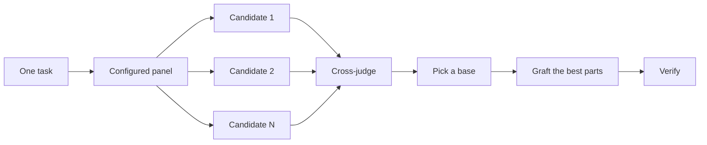

# コードを書く前に設計する（Design before you write code）

難しい設計を 1 回の試行で決めると、モデルが最初に思いついた形で固まってしまう。`/architect` は、実装の前に型と境界を決める。`/arena` は、同じ依頼文で複数の試行を走らせ、よいところを組み合わせる。`/interrogate` は、ほかのモデルに結果を壊しにかからせる。設計を組み上げることより網羅することが目的なら、`/swarm` が分担範囲ごとの作業やレースをファンアウトし、結果を集約する。

設計で最もよくある誤りは 2 つある。エージェントの最初の設計をそのまま採ることと、コードで一度も試していない計画を磨き込むことである。このページでは、その両方を正す。計画はコードを通して立てる。未解決の問いにはプロトタイプで答え、README かチュートリアルで目標を定め、文書の計画は最後に書く。


## `/architect` で形を決める（Settle the shape with `/architect`）

```text
/architect design the import pipeline before writing any code. i care most about how callers use it.
```

[`/architect`](../../skills/architect/SKILL.md) は、まず変更が触れるすべてのシステムを追う。次に、型、シグネチャ、モジュールの境界を備えた異なる形を 2 つ描き、状態のそれぞれに持ち主が 1 つだけあり、どのタスクにもやり方が 1 つだけあり、呼び出し元が知るべきことが最も少ないほうを選ぶ。規模が大きい設計や意見の分かれる設計では、単独で描く代わりに `/arena` を実行する。コードを書く前に設計を見たいなら、プロンプトでそう伝える。

コードを書き始めたら設計に手を付けてはならない、ということはない。同じ回避策が何度も必要になるなら、`/architect` は回避策を継ぎ足すのではなく設計をやり直す。

## `/arena` で試行をファンアウトする（Fan out attempts with `/arena`）

```text
/arena take my prompt to the arena verbatim. i want to compare their proposals with yours.
```

[`/arena`](../../skills/arena/SKILL.md) は、その下で動く汎用の道具である。N 個のサブエージェントが、同じ設計またはコードの依頼文に並行して取り組み、それぞれ専用の worktree かディレクトリに書き出す。別のベンダーのモデルによる読み取り専用のジャッジが、すべての候補を評価基準に照らして採点する。ほかのベンダーのモデルを動かせないときは、コーディネーターがジャッジを省き、ベースを自分で選ぶ。コーディネーターは各候補を最初から最後まで読み、ベースを選び、選ばれなかった候補からよいアイデアを取り込み、結果を検証する。



パネルは [`/setup-pstack`](../../skills/setup-pstack/SKILL.md) の設定から決まり、タスクごとに調整できる。重要な決定なら候補を増やし、そうでなければ減らすよう頼む。

```text
/arena this, 5 candidates. the cache key format is expensive to change later.
```

## `/swarm` で分担範囲とレースを網羅する（Cover slices and races with `/swarm`）

```text
/swarm check every package under packages/ against its check.sh. one worker per package. one report.
```

[`/swarm`](../../skills/swarm/SKILL.md) は、N 個のワーカーを、独立した分担範囲、網羅のためのマトリクス、関門テスト（gauntlet）のレーン、探索の区画、宣言済みのレースのアームに割り振る。各ワーカーは自分の範囲と確認方法を受け取り、`PASS`、`ISSUES`、`BLOCKED` のどれかを報告する。親はワーカーを待ち、抜けや脱落があればそれも含めて、簡潔な報告を 1 つ返す。

並列化で網羅できる範囲が広がるときや、独立した確認を競わせたいときに使う。`/arena` は、すべてのワーカーに同じ設計またはコードの依頼文を渡し、ベースを選んでよいところを取り込む。`/swarm` は、分担範囲を網羅するか、選び方を最初に宣言してレースを走らせる。ベースを選んで取り込むという手続きは使わない。

## `/interrogate` で壊してみる（Break it with `/interrogate`）

```text
/interrogate the whole branch, but skeptically. no nitpicks unless it's an actual bug or regression.
```

[`/interrogate`](../../skills/interrogate/SKILL.md) は、変更とその意図を、設定したモデルで動く攻撃役に渡す。攻撃役はそれぞれ、実際のコードに対して実行することで変更を壊そうとする。攻撃役によって見つける失敗は異なる。指摘が残るのは、そのコマンドを再実行して、意図を損なう失敗が現れたときだけである。報告には、検証済みの指摘をすべて、それを見つけた攻撃役とともに並べ、続いて各攻撃役が取り下げたものとその理由を載せる。修正は何も適用しない。

Dropped（取り下げた指摘）の一覧も読む。判定は覆してよい。

## 議論する代わりにプロトタイプを作る（Prototype instead of debating）

最初の設計を決してそのまま採らない。いくつか出してもらい、目で見て確かめられる証拠から選ぶ。

```text
/poteto-mode prototype a few options for the new dropdown menu. take screenshots or videos for me to compare.
```

[プロトタイプ（Prototype）のプレイブック](../../skills/poteto-mode/playbooks/prototype.md) は、作業用のディレクトリに使い捨ての試作を作り、複数の案を 1 つの切り替えスイッチで選べるようにし、それぞれを操作して、スクリーンショットや所要時間を記録する。UI だけでなく、振る舞いやアルゴリズムにも使える。プロトタイプは、コードによる計画である。プロトタイプがあれば、エージェントはユーザーに尋ねる代わりに何かを動かして自分の未解決の問いに答えられ、ユーザーなら思いつかなかったはずの選択肢が出てくる余地も残る。

同じ考え方は、実際の設計にも広げられる。`/architect` とプロトタイプを組み合わせ、レビューの関門を残す。

```text
/poteto-mode we need rate limiting for external webhooks. /architect it first, and answer open questions with prototypes. let me review before proceeding.
```

抽象的な計画に攻撃役を費やさない。`/interrogate` は実行で証明されない指摘をすべて取り下げるので、裏付けるコードのない計画には、攻撃役が壊せるものがほとんどない。プロトタイプで問いに決着をつけてから、作ったものをレビューする。

## 共有するコードでは README を先に書く（Write the README first for shared code）

ほかのコードから使われるパッケージや API では、利用者が読む文書から始める。

```text
/poteto-mode write a tutorial for how i would use the new config package first. then /teach me why it beats the current one.
```

チュートリアルを先に書くと、呼び出し元の視点に立たざるを得なくなる。仮想の利用者に向けて API を説明し、そこから実装へとさかのぼっていく。その文書は、エージェントが自分の作業を照らし合わせる具体的な目標にもなる。文書そのものが重要なときは [`/technical-writing`](../../skills/technical-writing/SKILL.md) を名指しする。そうすれば、チュートリアルがリファレンスと解説を同時に兼ねたものへずれていかず、チュートリアルのまま保たれる。

## 設計が固まってから計画する（Plan after the design settles）

pstack には、意図して計画用のスキルを置いていない。文書の計画がどうしても欲しいときは、設計が固まってから頼む。

```text
/poteto-mode turn this design into a plan. small verifiable PRs, each with its own verification steps.
```

[複数フェーズの計画（Multi-phase plan）のプレイブック](../../skills/poteto-mode/playbooks/multi-phase-plan.md) は、残った未解決の問いをプロトタイプで解決してから、PR ごとに 1 つの節を書く。各節の最後には、変更が動くことの証明を置く。テストスイートが通るだけでは、その証明にならない。計画そのものが成果物である。プレイブックは計画を実装せず、実行はユーザーが開始を指示したときにだけ始まる。

移行では、満たすべき水準をプロンプトに書く。

```text
/poteto-mode plan the migration of our ui library to the new styling system. small verifiable PRs, each with visual regression checks. the result must match the original exactly, bugs included.
```

「bugs included」（バグも含めて）と書けば、移行の途中で黙って不具合を直してしまい、新旧の出力を比べられなくなることを防げる。何日にもわたるプロジェクトでは、ほかのエージェントが進行中の作業を把握できるよう、しばらく計画をリポジトリにコミットしておいてもよい。作業がマージされたら削除する。

## タスクにどれだけの設計が必要か（How much design work does a task deserve?）

すべての変更にこれが必要なのか、と思うかもしれない。そうではない。ほとんどの変更には、どれも要らない。おおまかな段階は次のとおりである。

- 仕上がっているが自信のない小さな変更には、`/interrogate` だけでよい。
- 関数の境界をまたぐ変更や、所有者を移す変更には `/architect` を使う。設計が大きいか意見が分かれるなら、`/architect` が `/arena` も呼ぶ。
- 命名、形式、アルゴリズムのように、独立した試行が役立つ単独の決定には、`/arena` を直接使う。
- 網羅のためのマトリクス、並列の確認の集まり、アームを宣言したレースには `/swarm` を使う。
- レイアウト、所要時間、やり方のように、何かを動かせば答えが出る未解決の問いには、議論ではなくプロトタイプで答える。
- 意見が分かれ、後から戻すのが高くつく設計には、`/architect` を使い、出す前に `/interrogate` をかける。
- 複数の PR にまたがる作業には、設計が固まってから計画を書く。

`/poteto-mode` は、すでにこの段階に従っている。境界をまたぐ作業では `/architect` が自動的に動くので、これらを直接使うのは、主に既定より厳しく、または緩く確かめたいときである。

次は [変更を作り、diff をきれいにする（Build and clean the change）](./05-build-and-clean.md)。
