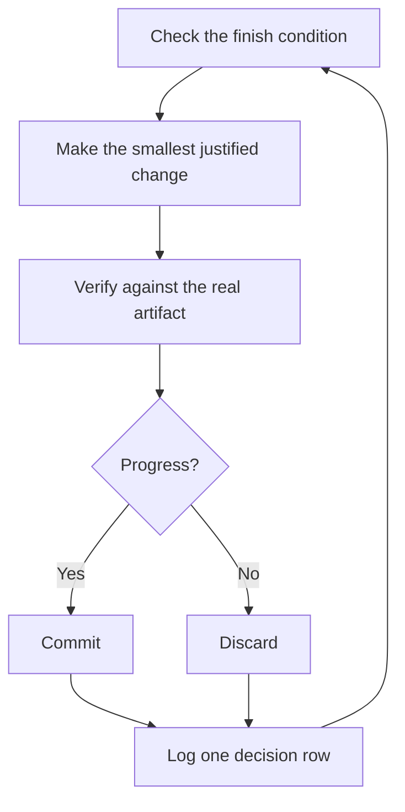

# 寝ているあいだに作業を進める（Run work while you sleep）

ここまでのすべては、このための準備である。自分の作業を自分で検証すると信頼できるエージェントなら、難しいタスクを任せたまま離れられる。それを安全にするのは期待ではない。確かめられる完了条件、隔離された worktree か cloud agent、そして朝に監査する決定ログである。


## ループの前に信頼を得る（Earn the trust before the loop）

信頼できないループは、未検証の作業を速く生み出すだけで、反復のたびに混乱が積み重なる。ループを動かしたまま離れる前に、それだけの信頼に値するかを確かめる。

- そのタスクを一度手でやったか、エージェントがやるのを見ていて、よい結果がどういうものか分かっている。
- 自分が使うのと同じツールや手がかりを、エージェントが持っている。検証スキル、プロファイラー、ログなどである。
- どの段階も自分の作業を証明し、作業が基準に届かなければラインを止められる。
- トランスクリプトをいくつか読み、繰り返し起きる失敗を、ツール、スキル、チェックに変えてある。

4 つがすべて成り立ってから、ループを自律させる。それまでは、見ている前で動かす。

## 夜間の無人実行の取り決め（The overnight contract）

よい引き継ぎには、目標、完了条件、許可、そして逃げ道がある。長くなくてよい。

```text
/poteto-mode im going to bed. migrate every caller to the new parser in a fresh worktree off <base>.
done means zero old callers, all parser fixtures pass, old api deleted.
keep a decision log. don't ask me before committing.
/loop until done. if you're truly stuck after a few hours, stop and write up why.
```

各行で何が得られるかを順に見る。

- 「im going to bed」は、セッションの設定を上書きする。エージェントは質問するのをやめ、作業を続ける。
- 「done means...」は、目標を、どの反復でも実行できるチェックに変える。
- 「fresh worktree off `<base>`」により、この実行が、ほかに開いている作業とぶつからない。
- 「don't ask me before committing」は、エージェントがこれがなければ止まって待つはずの許可に、前もって答えておく。
- `/loop` は pstack のスキルではなく、Cursor に組み込まれた、エージェントを再び起こす仕組みである。[自律実行（Autonomous run）プレイブック](../../skills/poteto-mode/playbooks/autonomous-run.md)はこれを使い、イベントや一定間隔の合図（heartbeat）のたびに完了条件を確かめ直す。
- 逃げ道があれば、本当に行き詰まったときに止まって理由を書き残せる。目標を 8 時間かけて都合よく解釈し直されるより、ずっとよい。

この作業は離れたあとにレビューすることになるので、`/poteto-mode` はこれを [`/figure-it-out`](../../skills/figure-it-out/SKILL.md) に振り分ける。`/figure-it-out` は、コードを書く前に実行のフェーズを設計し、決定ログを組み込む。

実行を意図して止めたいときは、エージェントに一時停止するよう伝えるか、これからオフラインになる、または Cursor を再起動すると伝える。[安全な一時停止（Pause safely）プレイブック](../../skills/poteto-mode/playbooks/pause-safely.md)は、いまの手順を終えるか取り消し、作業途中のチェックポイントをコミットし、再開用のメモを書く。新しいチャットは、セッションの引き継ぎ（Session pickup）プレイブックを通して、そのメモから作業を再開する。「keep going」と言っても、一時停止が始まることは決してない。

## ループが夜通しやること（What the loop does all night）



反復ごとに、変更 1 つ、チェック 1 つ、ログ 1 行。役に立たなかった変更は、そのまま残さずに捨てる。改善が頭打ちになったら、止まるのではなく方向を変える。完了条件が、勝利を宣言するためにこっそり緩められることも決してない。

## 朝の監査（The morning audit）

実行をレビューできるものにするのが、[`/show-me-your-work`](../../skills/show-me-your-work/SKILL.md) である。`decisions.tsv`（複数の実行が同じディレクトリを共有するときは `.audit/<task-slug>.tsv`）という TSV に、時刻、フェーズ、決定、理由、証拠の場所、結果を 1 行ずつ記録する。既定ではローカルに置いたままである。作業の規模が大きく、レビュアーが結果を信頼するのにその記録が必要なときは、コミットする。

戻ってきたら、実行の内容をレビューしやすい形で求める。

```text
/show-me-your-work catch me up on what you did last night
```

このスキルは要約を返す前に、別のモデルファミリーのレビュアーを立ち上げて、記録とトランスクリプトを読ませる。返答の最後には Attention 節があり、注意して見るべきものが並ぶ。まずその節を読み、次にそこが指しているログの行を読む。読者がするのは決定の監査であって、一晩分の作業を読み直すことではない。

監査ではなく手早く状況を知りたいときは、作業を実行したチャットで [`/ketchup`](../../skills/ketchup/SKILL.md) を実行する。読むだけで何も変えず、最後のメッセージ以降に何が変わったかを、作業で生まれたスクリーンショットや小さな図を添えて、平易な言葉で伝える。そのうえで、マージ、承認、選択肢からの選択など、読者の判断を待っている事項を 1 つずつ、エージェントの推す案、証拠、リスクとともに挙げる。返答だけを見て決められるようにするためである。

## 一晩の仕事がタスク 1 つではなくキューのとき（When the night holds a queue, not a task）

上の取り決めは、1 つのタスクを 1 つの完了条件まで進める。夜によっては、もっと多くを任せたいこともある。互いに独立した変更のキューや、大規模な取り組み全体である。2 つのプレイブックと 1 つのスキルで、同じ信頼の仕組みを大きな規模に広げられる。

[マージまでの自動実行（Autopilot-full）](../../skills/poteto-mode/playbooks/autopilot-full.md)は、互いに独立した PR のキューをマージまで進める。PR ごとに担当のエージェントが 1 つ付き、実装からマージまでを受け持つ。ただし、担当が自分の判定でマージすることはない。担当がコードを仕上げた時点の head を、新しい検証役の群れが確かめる。その後のリベースや小さな修正には新しい検証役が 1 つ付き、新しい振る舞いや大きな新しい差分があるときだけ、もう一度群れ全体を呼ぶ。マージを認めるのは、実際にマージされるパッチに対する問題なしの判定だけである。

```text
/poteto-mode full autopilot on this queue. each item is independent. i want them merged by morning.
```

[マージなしの自動実行（Autopilot-stack）](../../skills/poteto-mode/playbooks/autopilot-stack.md)は、マージまでの自動実行からマージを除いたものである。朝起きると、判定の付いた検証済みの PR が並んでおり、レビューとマージは自分で行う。PR を別の PR の上に積むのは、その PR に依存しているときだけである。何かがマージされる前に自分の目で確かめたいときは、マージまでの自動実行ではなくこちらを選ぶ。

```text
/poteto-mode autopilot these five changes, but don't merge. i'll land them in the morning.
```

多くのパッケージにまたがる移行のような大規模な取り組みには、専用のプレイブックはない。`/poteto-mode` は、大きな作業や横断的な作業を [`/figure-it-out`](../../skills/figure-it-out/SKILL.md) に振り分ける。`/figure-it-out` は、その作業のために厳密な実行を 1 つ設計する。

```text
/poteto-mode migrate every package to the new store. own it until each one is converted and merged. i'll check in twice a day.
```

## 多くのプロジェクトを並行して動かす（Run many projects in parallel）

[Cursor Project](https://cursor.com/blog/projects) では、コーディネーター役のエージェントが 1 つ、続けて使えるスレッドを持つ。コーディネーターはコードを書かず、サブエージェントに指示を出す。サブエージェントは既定でクラウドで動くので、ノートパソコンを閉じても作業は続く。コーディネーターへのプロンプトを `/poteto-mode` で始めれば、コーディネーターが立ち上げるサブエージェントはプレイブックに従う。コーディネーターが立ち上げる各エージェントは、まず [`worker.md`](../../skills/poteto-mode/worker.md) を読む。そのため、ワーカーは最初の依頼で示された基準を守り、やり直しのきく判断は読者に尋ねずに自分で下し、PR をレビューできる状態で開く。

次の習慣が役に立つ。

- 機能、移行、性能改善の取り組み、技術的負債の整理など、まとまった仕事ごとに Project を分ける。複数の Project を並行して動かせる。
- 関係するチャットを、終わったものも含めて Project にドラッグして入れる。それらは、Project 内のすべてのエージェントのコンテキストになる。
- 各 PR に、マージの前に検証役の群れを付ける。キューは、マージなしの自動実行（Autopilot-stack）かマージまでの自動実行（Autopilot-full）に任せる。
- コーディネーターには、データに裏付けられた計画を求め、未解決の問いには、読者に尋ねる前にプロトタイプで答えさせる。

調査から実行まで、Project 全体を 1 つのプロンプトで進められる。

```text
/poteto-mode refactor this repo so its architecture is more agent friendly. use /correct and /architect on past commits and review comments to find the mistakes agents make most here. use /recall for context from past chats. answer open questions with prototypes instead of asking me. come back with a plan backed by real data. once i approve it, run it with autopilot-stack or autopilot-full, and ask me which.
```

## ループが自動で始まるようにする（Let loops start themselves）

ここまでのループはどれも、まだ読者が始めるのを待っている。定期実行やイベント駆動の自動化を使えば、その手順もなくせる。ソフトウェアの保守は、これに向いた段階に分けられる。報告を選別し、再現し、修正し、修正を検証する。こうしたラインを信頼できるものに保つ規則が 2 つある。

- どの段階もラインを止められる。選別の段階は報告が想定どおりの振る舞いだと判断でき、再現の段階は再現に失敗することがあり、修正役は変更のリスクが高すぎると判断できる。こうした結果はどれも役に立つ。まずい作業が次の段階に進むのを防げるからであり、先の段階ほど取り消す手間が大きくなる。
- どの段階も証拠を引き渡す。再現の段階は壊れた状態のスクリーンショットと動画を添え、修正の段階は変更前後の証明を添える。そうすれば人間は、コードを 1 行も読まないうちに、エージェントが正しいものを直したかを確かめられる。

pstack は、これを Slack での不具合報告向けの[自動化パック](https://github.com/cursor/plugins/blob/main/pstack/automations/benny/README.md)として、無効の状態で同梱している。1 つ目の自動化は各報告を選別する。もう 1 つは確認されたバグを再現し、小さな修正をドラフトとして用意することもある。セットアップするには、エージェントにその [`FOR_AGENTS.md`](https://github.com/cursor/plugins/blob/main/pstack/automations/benny/FOR_AGENTS.md) を示し、対象のリポジトリを指定する。

**落とし穴：** 時間の長さは完了条件ではない。「work on this for 4 hours」では、エージェントが確かめられるものが何もなく、朝起きると、結果ではなく 4 時間分の動きだけが残っている。`/loop` には、成否を判定できる条件を与える。

次: [原則の名前で舵を取る](./08-principles.md)
